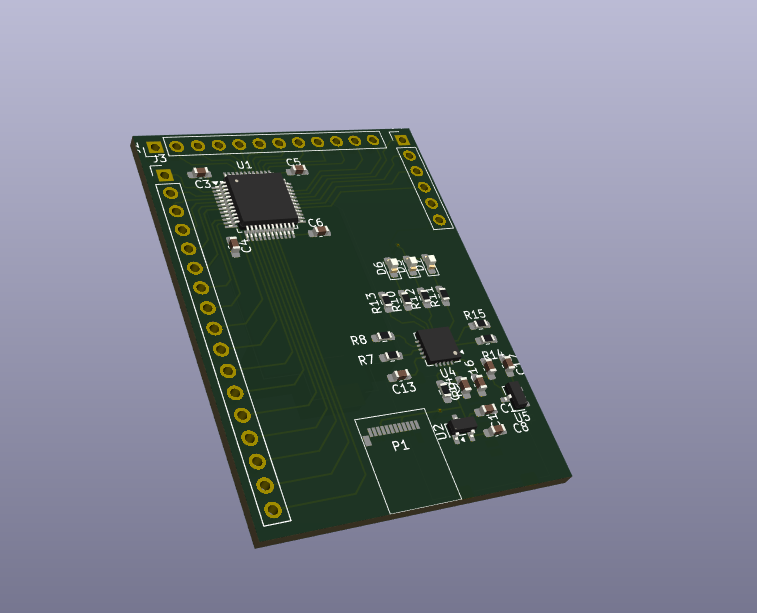

# Black Box – The $20 Industrial Data Logger

## The Problem

Machines fail months or years after installation with intermittent, unreproducible problems. Engineers can’t recreate the issue, and the root cause is lost forever.

At the same time, IoT and AI startups need real-world machine data to train models. The usual solution is a Raspberry Pi + sensors + enclosure + power + networking setup that costs hundreds of dollars, is bulky, power-hungry, and often unreliable in industrial environments. The cheapest commercial data loggers that can do similar work start around $500 and are still overkill or too expensive for widespread deployment.

## The Solution

**Black Box** is a tiny, ultra-low-cost data logger that you simply wire into a machine and leave for months or years. It continuously records analog and digital signals so you can later understand exactly what happened before a failure — or collect large amounts of real machine data for AI training.

### Core Hardware (target < $20, < 2" × 1")
- STM32 microcontroller
- 8 protected ADC inputs + 12 GPIOs
- microSD card for long-term storage
- Coin-cell battery that is constantly charged from the 5 V supply
- Programming interface (SWD / USB)

### Smart Power Behavior
- Runs fully from the machine’s 5 V supply while available
- When 5 V drops, the coin cell seamlessly takes over and keeps logging for ~15 minutes
- After that it drops into pure RTC mode (only keeps accurate time)
- When 5 V returns, the system powers up again and continues logging with correct timestamps

Everything that can be handled in firmware (power state machine, logging strategy, timekeeping, etc.) is done in firmware to keep the board simple and cheap.

## Product Roadmap
1. **Basic model** – SD card + battery (the pure “black box”)
2. **Wi-Fi model** – optional wireless upload
3. **Ethernet model** – for permanent installations

All variants stay under $20 in volume and smaller than 2" × 1".

## Software
A simple cross-platform desktop application that:
- Reads data from many Black Boxes at once
- Requires zero technical training
- Lets any technician or engineer extract and analyze months/years of signals in minutes

## Why It Wins
- **25× cheaper** than the cheapest comparable industrial loggers
- Tiny enough to hide inside almost any machine
- Survives power interruptions while keeping accurate time
- Perfect for two high-value use cases:
  1. Capturing elusive intermittent failures
  2. Cheap, scalable data collection for AI/IoT model training

## The Ask
We are raising **$20,000** to deliver a production-ready product that can be sold in volume. This covers:
- Final hardware design, testing, and certification
- Robust firmware
- Cross-platform extraction software
- First production batch and initial go-to-market

---

*For confidentiality reasons, the actual PCB design files, firmware source code, and software source code currently under development are not included in this repository.*

